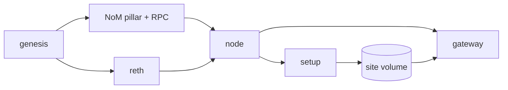

# zvm-devnet

A whole ZVM devnet on one machine: a fresh NoM chain of its own, the ZVM on
top of it, every service, every app's contracts and every page, behind one
address. Point a wallet, a page or a script at it in place of the public
devnet and nothing else changes.

```sh
git clone --recurse-submodules https://github.com/Zenoglyphs-VM/zvm-devnet
cd zvm-devnet
docker compose up -d
docker compose logs -f setup     # the first run deploys and builds, ~15 min
```

Then open http://localhost:47080. Needs Docker with Compose v2, about 8 GB of
memory and 10 GB of disk, and the internet on the first run (images, npm, solc).

## What is at the address

The paths every ZVM page and tool expects of a gateway:

| Path | What |
|---|---|
| `/zvm/rpc` | ZVM JSON-RPC, for wallets, Foundry, viem |
| `/zvm/api/*` | the node's read API |
| `/zenon` | NoM JSON-RPC, HTTP and WebSocket on one path (Syrius) |
| `/explorer/` `/glyphswap/` `/karum/` `/nft/` `/mozaic/` `/zchan/` `/zns/` `/spark/` | the apps |
| `/status/` | whether each part is answering, and the values to put in a wallet |
| `/glyphswap/faucet` | ZNN and QSR on either layer, to a `z1` or a `0x` address |

| Chain | ID |
|---|---|
| ZVM (EVM, currency ZNN) | 7340469 |
| NoM, with dynamic plasma | 69 |

## Pointing your own code at it

Every ZVM repository reads its endpoints from the environment. With the
devnet at its default address:

```sh
# pages (Vite, read at build time)
VITE_ZVM_NODE=http://localhost:47080/zvm
VITE_GATEWAY=http://localhost:47080
VITE_NOM_NODE=ws://localhost:47080/zenon

# Go services, the CLIs and scripts
ZVM_RPC=http://localhost:47080/zvm/rpc
ZVM_NODE=http://localhost:47080/zvm
NOM_NODE=http://localhost:47080/zenon
```

## Settings

All optional; copy `.env.example` to `.env` to change them.

| Variable | Default | |
|---|---|---|
| `ZVM_DEVNET_URL` | `http://localhost:47080` | the address browsers reach the gateway at; the pages are built against it |
| `ZVM_DEVNET_BIND` | `127.0.0.1` | `0.0.0.0` to open the gateway to the network |
| `ZVM_DEVNET_PORT` | `47080` | the gateway's host port |
| `DEVNET_ADMIN` | ZVM test account 0 | the address that holds every admin role |
| `OP_RETH_IMAGE` | `op-reth:v1.10.2` | the execution engine |

To serve the devnet to other machines, set `ZVM_DEVNET_URL` to the address
they will use and `ZVM_DEVNET_BIND=0.0.0.0`, then `docker compose up -d`. The
pages rebuild against the new address.

## How it starts



`genesis` writes both layers' genesis once, timestamped now. `setup` waits for
the node to catch up with NoM, deploys Uniswap V2 with a ZNN/QSR pool, the NFT
marketplace and farm, Mozaic, zchan, ZNS and Spark, funds the test accounts,
hands every admin role to the admin, builds every page against those contracts
and `ZVM_DEVNET_URL`, and ends with the sanity check. It runs on every `up`,
skips what is done, and exits 0 only when every check passed.

The contract addresses it wrote:

```sh
docker compose cp setup:/deploy .    # deployment records, accounts.json, keys/
```

## Sanity check

```sh
docker compose run --rm setup check
```

One line per check, and exit 1 if any failed. It checks NoM over HTTP and
WebSocket (producing, chain 69), the ZVM RPC (chain 7340469), derivation and
node health, the relayer, bridge, faucet, verifier and status prober, the
marketplace and media APIs, every page and its first script, that every
contract has code, that the admin holds every role, and that a transaction
sent through `/zvm/rpc` lands: relayer, NoM, derivation and back.

## Test data

```sh
docker compose run --rm setup seed
```

Fills the devnet with something to test against, from the test accounts:
three `.znn` names set as primary names, ZNN/wQSR swaps both ways and a
liquidity position, more NFT listings, painted Mozaic pixels, a zchan thread
with a reply, a Spark coin launched and bought, and the bridge both ways (a
withdrawal to NoM and a QSR deposit from it). Opt-in, so a fresh devnet stays
empty; each step runs once, and a second run sends nothing. Takes about five
minutes, most of it ZNS's commit wait. After a seed, `setup check` also reads
back the names, the wQSR balances, the zchan thread, the Spark coin and the
withdrawal.

## Test accounts

Both layers use go-zenon's devnet mnemonic, the one in
`go-zenon/docker/devnet/README.md`:

```
abstract affair idle position alien fluid board ordinary exist afraid chapter wood wood guide sun walnut crew perfect place firm poverty model side million
```

Import it into Syrius for the NoM accounts (Zenon's path, `m/44'/73404'/i'`),
and into MetaMask or Rabby for the ZVM accounts (Ethereum's path,
`m/44'/60'/0'/0/i`).

| NoM | | |
|---|---|---|
| 1 | `z1qq6eg8n43g032hanpsfp02qcdmv7zfj3y2lt5d` | 1,000,000 ZNN, 10,000,000 QSR |
| 3 | `z1qp3yph55qgresyytz83anynr2f4z39x2z3ej3e` | 50,000 ZNN, 500,000 QSR |
| 8 | `z1qpeet8dcjg0m6x6m3tg437wnc42aa2nez2fzth` | 50,000 ZNN, 500,000 QSR |
| 9 | `z1qqcam4ycu0ta8333hx38r5j2z3ry9jjfxkc7t5` | 50,000 ZNN, 500,000 QSR |

| ZVM | | |
|---|---|---|
| 0 | `0xD73f244650c92b2263719BfFd921De6FE991900D` | 10,000 ZNN; the admin |
| 1 | `0x54528274D9e108D9dfdBa40bCb6de7aF0385b7f3` | 10,000 ZNN; zchan's janitor |
| 2 to 9 | | 10,000 ZNN each |

NoM index 0 is the pillar's producer. Every key here is public: fine for a
devnet and nothing else. Keep `ZVM_DEVNET_BIND` at `127.0.0.1` unless the
network is yours.

## Admin

ZVM account 0 is the admin: it owns Mozaic, zchan, ZNS's root and controller,
Spark, the NFT marketplace and the farm, and is Uniswap V2's `feeToSetter`.
Import the mnemonic into MetaMask or Rabby to manage any of them. To keep the
admin private, set `DEVNET_ADMIN` to your own address before the first `up`;
every role goes there instead.

The NoM side's services run on the same mnemonic at Zenon's path: the bridge
vault is index 200, the faucet 201, the relayers 202 to 209
(`zvm-core/devnet`).

## Starting over

```sh
docker compose down -v    # removes the chain, the deployments and the pages
docker compose up -d
```

`docker compose down` without `-v` keeps everything; `up -d` resumes.

## Not included

Bullet and Rain are Telegram bots and need a bot token each; they run from
their own repositories against this devnet's `ZVM_RPC`.

## Licence

MIT. The submodules carry their own.

## Completed seed settlement qualification

The seed qualifies ZNN/QSR deposits and completed withdrawals with exact
recipient accounting, plus native and relayed calls. CI runs the seed and
`setup check --require-seed` after lightweight controls and the real stack build.
See [the qualification scope and recovery limits](docs/SEED_QUALIFICATION.md).
